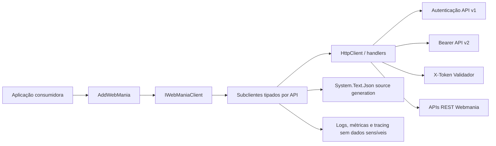
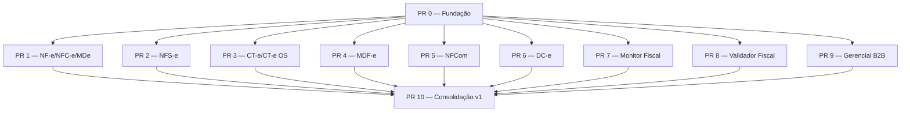

# Plano de implementação — DFeHub.Client

> Cliente .NET comunitário e não oficial para integração com as APIs fiscais e de
> faturamento da Webmania.

| Item | Definição |
| --- | --- |
| Estado | Planejamento |
| Versão do documento | 1.0 |
| Plataforma alvo | .NET 10 |
| Linguagem | C# 14 |
| Pacote proposto | `DFeHub.Client` |
| Assembly e namespace raiz | `DFeHub` |
| Licença recomendada | MIT |
| Marco de lançamento | Todas as APIs deste plano disponíveis em `1.0.0` |

## 1. Resumo executivo

O projeto criará um pacote NuGet de código aberto que encapsula as APIs REST da
Webmania usando o `HttpClient` padrão do .NET. O consumidor trabalhará com métodos
assíncronos, parâmetros tipados e respostas desserializadas, sem precisar montar
URLs, cabeçalhos, JSON ou interpretar manualmente os erros HTTP.

A versão 1 incluirá todas as APIs fiscais e de faturamento identificadas no catálogo
oficial:

1. NF-e, NFC-e, CC-e e Manifestação do Destinatário;
2. NFS-e;
3. CT-e e CT-e OS;
4. MDF-e;
5. NFCom;
6. DC-e;
7. Monitor Fiscal;
8. Validador Fiscal;
9. Gerencial B2B.

Cada API será entregue em uma pull request própria. Antes delas haverá uma PR de
fundação, e depois uma PR de consolidação da versão 1. A versão estável `1.0.0` não
será publicada com cobertura funcional parcial.

O projeto terá testes unitários, testes de contrato baseados em exemplos oficiais,
testes de homologação opt-in, relatório de cobertura, validação de compatibilidade
do pacote e publicação automatizada no NuGet.

## 2. Objetivos

- Cobrir todos os endpoints e modelos públicos das APIs fiscais e de faturamento
  previstas para a versão 1.
- Oferecer uma API pública idiomática para C# e consistente entre os produtos.
- Usar `HttpClient` e `IHttpClientFactory`, com integração nativa à injeção de
  dependência do .NET.
- Expor operações assíncronas e aceitar `CancellationToken`.
- Usar modelos fortes para requisições e respostas.
- Preservar os detalhes fiscais sem conversões que causem perda de precisão ou de
  zeros à esquerda.
- Transformar respostas de erro da API em exceções tipadas e diagnosticáveis.
- Ser seguro por padrão: sem credenciais ou conteúdo fiscal sensível em logs.
- Permitir manutenção comunitária por meio de documentação, testes e governança
  abertas.
- Publicar símbolos, Source Link e documentação XML junto ao pacote.
- Detectar regressões de contrato, serialização e compatibilidade da API pública no
  CI.

## 3. Fora do escopo da versão 1

- Criar regras fiscais próprias ou substituir a validação da Webmania/SEFAZ.
- Persistir notas, eventos, XMLs ou PDFs em banco de dados.
- Implementar filas, outbox, agendamento ou processamento em background na
  aplicação consumidora.
- Gerenciar certificados digitais fora das operações expressamente expostas pela
  API.
- Oferecer uma abstração genérica para trocar de provedor fiscal em tempo de
  execução.
- Cobrir APIs utilitárias de CEP e IBGE. Elas poderão entrar em uma versão posterior
  e não bloqueiam `1.0.0`.
- Garantir compatibilidade com runtimes anteriores ao .NET 10 na primeira versão.

## 4. Nome, marca e identidade do projeto

### 4.1 Nome recomendado

- Repositório: `DFeHub`
- Pacote NuGet: `DFeHub.Client`
- Assembly: `DFeHub`
- Namespace raiz: `DFeHub`
- Namespace do provedor: `DFeHub.Providers.WebMania`
- Método de registro: `AddWebMania`
- Fachada principal: `IWebManiaClient`

`DFeHub` comunica a finalidade do projeto sem apresentar o pacote como produto
oficial da Webmania. A marca ainda aparece de forma descritiva na integração, no
namespace do provedor e no método de configuração.

A pesquisa inicial não encontrou os IDs exatos `DFeHub` e `DFeHub.Client` no NuGet,
mas uma busca não reserva o nome nem substitui uma verificação jurídica. Antes da
primeira publicação será necessário:

1. verificar novamente o ID no NuGet;
2. pesquisar marcas e projetos homônimos;
3. reservar o ID publicando um pacote pré-release válido;
4. confirmar o nome da organização e do repositório no GitHub.

Alternativas caso o nome deixe de estar disponível:

- `DFeConnect.Client`;
- `OpenDFe.Client`;
- `FiscalSdk.WebMania`.

### 4.2 Uso da marca Webmania

O README e a descrição do NuGet deverão informar de modo visível:

> Este é um SDK comunitário e não oficial. Webmania é marca de seus respectivos
> titulares. Este projeto não possui afiliação, endosso ou suporte oficial da
> Webmania.

Não serão usados logotipo, identidade visual ou elementos que sugiram produto
oficial sem autorização expressa. Uma revisão jurídica é recomendada antes do
lançamento; este plano não constitui aconselhamento jurídico.

## 5. Escopo funcional da versão 1

O inventário definitivo de operações será congelado em uma matriz de contrato no
início de cada PR. A fonte de verdade será, nesta ordem:

1. documentação REST oficial atual;
2. coleção oficial do Postman;
3. comportamento observado no ambiente de homologação;
4. SDK PHP oficial e implementação C# existente, usados como referência secundária.

Quando código legado divergir da documentação REST atual, prevalecerão a
documentação atual e a homologação. A divergência será registrada em um ADR ou na
matriz da API.

### 5.1 NF-e, NFC-e, CC-e e MDe

Cobertura alvo:

- emissão de NF-e e NFC-e;
- consulta de situação e resultado do processamento;
- cancelamento;
- carta de correção;
- inutilização de numeração;
- emissão de documentos complementares, de ajuste ou devolução quando representados
  pelo contrato da API;
- download/recuperação dos artefatos disponíveis, incluindo XML e DANFE;
- consulta e manifestação do destinatário;
- ciência da operação, confirmação, desconhecimento e operação não realizada;
- todos os demais eventos e consultas presentes na documentação REST vigente.

Os modelos deverão cobrir emitente, destinatário, produtos, impostos, transporte,
pagamentos, cobranças, intermediador, referências e campos adicionais suportados.

### 5.2 NFS-e

Cobertura alvo:

- consulta de provedores e municípios suportados;
- consulta de disponibilidade ou status municipal;
- emissão direta e emissão pelos fluxos de RPS/lote disponibilizados;
- consulta da NFS-e, RPS e lote;
- cancelamento e substituição;
- manifestação e demais eventos documentados;
- agendamento/consulta de cancelamento, quando aplicável;
- prestadores e tomadores nacionais ou estrangeiros;
- serviços, retenções, deduções, reembolsos e construção civil;
- ISS e campos da transição tributária, incluindo IBS/CBS quando expostos pela API;
- download dos artefatos disponíveis;
- particularidades municipais e do padrão nacional sem perder a tipagem comum.

O desenho terá um núcleo comum e modelos específicos somente onde a diferença entre
provedores/municípios não puder ser expressa com segurança pelo contrato comum.

### 5.3 CT-e e CT-e OS

Cobertura alvo:

- emissão de CT-e;
- emissão de CT-e OS;
- consulta;
- cancelamento;
- carta de correção;
- inutilização e eventos disponíveis;
- modelos modais e documentos vinculados previstos pela API;
- download de XML, DACTE e demais artefatos expostos;
- todos os endpoints documentados para os dois tipos de documento.

### 5.4 MDF-e

Cobertura alvo:

- emissão;
- consulta;
- cancelamento;
- encerramento;
- inclusão e alteração de informações por eventos quando suportadas;
- condutores, veículos, percursos, municípios de carga/descarga e documentos
  vinculados;
- download de XML, DAMDFE e demais artefatos;
- todos os demais endpoints documentados.

### 5.5 NFCom

Cobertura alvo:

- emissão;
- consulta;
- cancelamento, substituição e eventos disponibilizados;
- assinantes, contratos, itens, tributos e cobranças;
- download de XML, documento auxiliar e demais artefatos;
- todos os endpoints e modelos da documentação vigente.

### 5.6 DC-e

Cobertura alvo:

- emissão;
- consulta;
- cancelamento e eventos disponibilizados;
- participantes, operações, itens, tributos e documentos relacionados;
- download de XML, representação auxiliar e demais artefatos;
- todos os endpoints e modelos da documentação vigente.

### 5.7 Monitor Fiscal

Serão implementados todos os endpoints de configuração, acompanhamento, consulta,
situação, alertas e resultados expostos pela API oficial. Como o produto pode
evoluir independentemente dos documentos fiscais, a PR começará com uma matriz de
contrato própria e fixtures versionadas.

### 5.8 Validador Fiscal

Cobertura alvo:

- submissão dos documentos/dados aceitos;
- consulta de situação de validações assíncronas;
- obtenção do resultado detalhado;
- representação tipada de erros, alertas e regras;
- polling explícito e cancelável, quando necessário;
- todos os formatos e endpoints aceitos pela documentação vigente.

O polling usará `TimeProvider`, respeitará `CancellationToken`, limite de tentativas,
intervalo configurável e, quando presente, `Retry-After`.

### 5.9 Gerencial B2B

Serão implementadas todas as operações de faturamento e gestão expostas pela API,
incluindo os fluxos de cadastro, consulta, atualização, contratação/licenciamento e
credenciais que constarem da matriz oficial.

Credenciais retornadas pela API serão tratadas como segredo:

- não aparecerão em `ToString()`;
- não serão registradas em logs;
- não serão incluídas em mensagens de exceção;
- terão exemplos mascarados na documentação e nas fixtures.

## 6. Experiência de uso

### 6.1 Registro global

O pacote terá um único ponto de entrada:

```csharp
builder.Services.AddWebMania(
    builder.Configuration.GetSection("Fiscal:WebMania"));
```

Também será oferecida configuração por delegate:

```csharp
builder.Services.AddWebMania(options =>
{
    options.ApiV1.ConsumerKey = configuration["WEBMANIA_V1_CONSUMER_KEY"];
    options.ApiV1.ConsumerSecret = configuration["WEBMANIA_V1_CONSUMER_SECRET"];
    options.ApiV1.AccessToken = configuration["WEBMANIA_V1_ACCESS_TOKEN"];
    options.ApiV1.AccessTokenSecret =
        configuration["WEBMANIA_V1_ACCESS_TOKEN_SECRET"];

    options.ApiV2.AccessToken = configuration["WEBMANIA_V2_ACCESS_TOKEN"];
    options.Validator.Token = configuration["WEBMANIA_VALIDATOR_TOKEN"];

    options.B2B.ConsumerKey = configuration["WEBMANIA_B2B_CONSUMER_KEY"];
    options.B2B.ConsumerSecret = configuration["WEBMANIA_B2B_CONSUMER_SECRET"];
    options.B2B.AccessToken = configuration["WEBMANIA_B2B_ACCESS_TOKEN"];
    options.B2B.AccessTokenSecret =
        configuration["WEBMANIA_B2B_ACCESS_TOKEN_SECRET"];
});
```

Os nomes finais das propriedades acompanharão a nomenclatura da documentação
oficial. Segredos não devem ser mantidos em `appsettings.json` versionado; os
exemplos usarão variáveis de ambiente, Secret Manager ou cofre de segredos.

### 6.2 Fachada agregadora

```csharp
public interface IWebManiaClient
{
    INFeClient NFe { get; }
    INFSeClient NFSe { get; }
    ICTeClient CTe { get; }
    IMDFeClient MDFe { get; }
    INFComClient NFCom { get; }
    IDCeClient DCe { get; }
    IMonitorFiscalClient Monitor { get; }
    IValidatorFiscalClient Validator { get; }
    IB2BClient B2B { get; }
}
```

Uso:

```csharp
public sealed class EmitirNotaHandler(IWebManiaClient webMania)
{
    public Task<NFeIssueResponse> HandleAsync(
        NFeIssueRequest request,
        CancellationToken cancellationToken)
    {
        return webMania.NFe.IssueAsync(request, cancellationToken);
    }
}
```

Cada subcliente também poderá ser injetado diretamente:

```csharp
public sealed class EmitirServicoHandler(INFSeClient nfseClient)
{
    public Task<NFSeIssueResponse> HandleAsync(
        NFSeIssueRequest request,
        CancellationToken cancellationToken)
    {
        return nfseClient.IssueAsync(request, cancellationToken);
    }
}
```

### 6.3 Convenções da API pública

- Sufixo `Async` em toda operação de rede.
- `CancellationToken cancellationToken = default` como último argumento.
- `Task<TResponse>` para operações HTTP.
- Requisição encapsulada em um objeto quando houver mais de um valor de negócio.
- Parâmetros de rota simples podem ser tipos de valor específicos, por exemplo
  `NFeAccessKey`, em vez de `string` sem semântica.
- Respostas de sucesso retornam modelos tipados.
- Erros HTTP/API lançam exceções tipadas.
- Downloads grandes serão transmitidos como `Stream`, sem buffer obrigatório em
  memória.
- Nenhum `dynamic`, `JObject` ou `Dictionary<string, object>` na API pública.
- Nenhum tipo de `HttpRequestMessage`/`HttpResponseMessage` será exigido do
  consumidor para operações comuns.
- Os nomes públicos usarão a grafia habitual do domínio: `NFe`, `NFSe`, `CTe`,
  `MDFe`, `NFCom` e `DCe`.

## 7. Arquitetura

### 7.1 Visão geral



### 7.2 Transporte HTTP

- `IHttpClientFactory` gerenciará os handlers e o ciclo de conexões.
- Cada família de autenticação terá cliente/handler próprio.
- Endereços base oficiais serão centralizados e poderão ser sobrescritos para
  testes, homologação ou proxy.
- `HttpRequestMessage` e `HttpResponseMessage` sempre serão descartados
  corretamente.
- Respostas serão lidas com `HttpCompletionOption.ResponseHeadersRead`.
- O corpo de erro terá limite de leitura para impedir uso de memória sem controle.
- O timeout será configurável e não substituirá o `CancellationToken`.
- O `User-Agent` identificará pacote e versão, sem dados da aplicação.
- Será aceito `IHttpClientBuilder` de customização para casos avançados, mantendo
  padrões seguros.

### 7.3 Autenticação

Existem três esquemas que não devem ser misturados:

| Grupo | APIs | Esquema |
| --- | --- | --- |
| API 1.0 | NF-e/NFC-e/MDe | Quatro cabeçalhos `X-*` |
| API 1.0 B2B | Gerencial B2B | Quatro cabeçalhos `X-*`, credenciais próprias |
| API 2.0 | NFS-e, CT-e, MDF-e, NFCom, DC-e e Monitor Fiscal | Bearer token |
| Validador | Validador Fiscal | Cabeçalho `X-Token` |

Os nomes exatos dos cabeçalhos serão mantidos em código interno e verificados por
testes de contrato.

A configuração global pode conter apenas as credenciais das APIs usadas pela
aplicação. A ausência de credenciais de, por exemplo, B2B não impedirá o uso de
NF-e. A validação ocorrerá na primeira utilização do subcliente correspondente e
produzirá `WebManiaConfigurationException` com indicação do grupo ausente, sem
revelar valores.

### 7.4 Resiliência

Operações fiscais mutáveis não terão retry automático por padrão, pois uma repetição
pode emitir ou registrar o mesmo evento mais de uma vez.

- POSTs de emissão, cancelamento e eventos: sem retry implícito.
- Consultas idempotentes: poderão receber retry limitado e opt-in.
- `Retry-After` será respeitado quando aplicável.
- Polling terá política própria, explícita e testável.
- Falhas transitórias permanecerão visíveis ao consumidor.
- Se a API introduzir chave de idempotência documentada, o suporte será adicionado
  por operação e coberto por teste.

### 7.5 Serialização

Será usado `System.Text.Json` com source generation:

- um `JsonSerializerContext` por API;
- composição por `TypeInfoResolverChain` internamente;
- `[JsonPropertyName]` explícito quando o wire format não coincidir com C#;
- conversores específicos por propriedade ou tipo, nunca conversão global arriscada;
- `[JsonExtensionData]` em respostas apropriadas para preservar campos novos;
- tratamento documentado de `null`, campo ausente e coleção vazia;
- snapshots/fixtures para garantir o JSON exato.

### 7.6 Modelagem fiscal

- CNPJ, CPF, CEP, chaves de acesso, códigos fiscais e números que possam conter
  zeros à esquerda serão `string` ou value objects baseados em `string`.
- Valores monetários, bases, alíquotas e quantidades usarão `decimal`.
- Nunca será usado `double` para valores fiscais.
- Datas sem horário usarão `DateOnly` quando o contrato permitir.
- Instantes usarão `DateTimeOffset`.
- Enums serão usados somente para conjuntos estáveis. Campos extensíveis usarão
  tipos que preservem valores desconhecidos.
- Propriedades obrigatórias usarão `required`/construtores quando isso não prejudicar
  a desserialização.
- Requisições imutáveis preferirão `sealed record`.
- Value objects pequenos poderão usar `readonly record struct`.
- Respostas poderão aceitar extensão do provedor sem quebrar consumidores.
- Modelos de request e response não serão compartilhados só por terem a mesma forma;
  a semântica e a evolução de cada contrato prevalecem.

### 7.7 Validação

O SDK fará validações determinísticas que melhorem a experiência sem tentar
reimplementar toda a legislação:

- campos obrigatórios;
- tamanho e formato estrutural;
- coleções mínimas/máximas documentadas;
- coerência simples entre campos discriminados;
- credenciais necessárias ao subcliente.

Validações fiscais dependentes de legislação, município, regime ou interpretação da
SEFAZ continuarão a cargo da API. Erros locais usarão
`WebManiaValidationException`, contendo uma coleção de falhas por caminho da
propriedade.

### 7.8 Erros

Hierarquia proposta:

```text
WebManiaException
├── WebManiaConfigurationException
├── WebManiaValidationException
├── WebManiaTransportException
└── WebManiaApiException
    ├── WebManiaAuthenticationException
    ├── WebManiaRateLimitException
    └── WebManiaServerException
```

`WebManiaApiException` deverá preservar, quando disponíveis:

- status HTTP;
- código e mensagem retornados;
- erros de campo;
- identificador da requisição/correlação;
- produto/operação chamada;
- conteúdo bruto limitado e sanitizado somente quando seguro.

Não serão colocados na exceção credenciais, documentos completos ou conteúdo fiscal
desnecessário. Cancelamento solicitado pelo chamador continuará sendo
`OperationCanceledException`.

### 7.9 Downloads

Artefatos binários ou textuais terão um contrato comum, por exemplo:

```csharp
public sealed class FiscalDocumentFile : IAsyncDisposable
{
    public required Stream Content { get; init; }
    public string? FileName { get; init; }
    public string? MediaType { get; init; }
    public long? Length { get; init; }
}
```

O formato final deve garantir que o `HttpResponseMessage` permaneça vivo enquanto o
stream estiver sendo lido e seja descartado por `DisposeAsync`.

## 8. Estrutura do repositório

```text
/
├── .github/
│   ├── workflows/
│   ├── ISSUE_TEMPLATE/
│   ├── dependabot.yml
│   └── pull_request_template.md
├── docs/
│   ├── adr/
│   ├── contracts/
│   │   ├── nfe.md
│   │   ├── nfse.md
│   │   ├── cte.md
│   │   ├── mdfe.md
│   │   ├── nfcom.md
│   │   ├── dce.md
│   │   ├── monitor-fiscal.md
│   │   ├── validador-fiscal.md
│   │   └── gerencial-b2b.md
│   └── examples/
├── samples/
│   └── DFeHub.Sample.Api/
├── src/
│   └── DFeHub.Client/
│       ├── DependencyInjection/
│       ├── Diagnostics/
│       ├── Exceptions/
│       ├── Http/
│       │   ├── Authentication/
│       │   ├── ApiV1/
│       │   ├── ApiV2/
│       │   └── Validator/
│       ├── Providers/
│       │   └── WebMania/
│       │       ├── NFe/
│       │       ├── NFSe/
│       │       ├── CTe/
│       │       ├── MDFe/
│       │       ├── NFCom/
│       │       ├── DCe/
│       │       ├── Monitor/
│       │       ├── Validator/
│       │       └── B2B/
│       ├── Serialization/
│       └── Validation/
├── tests/
│   ├── DFeHub.Client.UnitTests/
│   ├── DFeHub.Client.ContractTests/
│   ├── DFeHub.Client.IntegrationTests/
│   └── DFeHub.Client.PackageTests/
├── .editorconfig
├── Directory.Build.props
├── Directory.Packages.props
├── DFeHub.slnx
├── global.json
├── LICENSE
├── README.md
├── CONTRIBUTING.md
├── SECURITY.md
└── PLANO_DE_IMPLEMENTACAO.md
```

Inicialmente haverá um único pacote para simplificar instalação e descoberta. A
separação interna por produto impedirá acoplamento. A divisão em vários pacotes só
será considerada após `1.0.0`, com evidência de necessidade e sem quebrar a
experiência de `AddWebMania`.

## 9. Padrões de .NET 10 e C# 14

### 9.1 Configuração de build

- Target framework único: `net10.0`.
- SDK 10 fixado em `global.json`, com roll-forward de patch apropriado.
- Solution no formato `.slnx`.
- Nullable reference types habilitados.
- Implicit usings habilitados quando melhorarem a leitura.
- Warnings tratados como erros no CI.
- Analisadores .NET no nível mais recente compatível.
- Build determinístico e `ContinuousIntegrationBuild`.
- Central Package Management em `Directory.Packages.props`.
- Documentação XML para toda a API pública.
- Source Link e repositório incorporado aos metadados do pacote.
- Símbolos publicados em `.snupkg`.
- `PackageReadmeFile`, licença, ícone próprio e metadados completos.
- Package validation e baseline de compatibilidade após a primeira versão estável.

### 9.2 Estilo

Serão usados quando trouxerem clareza:

- file-scoped namespaces;
- primary constructors;
- records;
- `required` e `init`;
- collection expressions;
- pattern matching;
- interpolated string handlers apenas se necessários;
- `ConfigureAwait(false)` conforme a política definida para a biblioteca.

Recursos novos não serão usados apenas por novidade. Legibilidade do contrato
público e compatibilidade de serialização têm prioridade.

### 9.3 Trimming e Native AOT

A source generation de JSON reduzirá dependência de reflexão. O CI publicará um
aplicativo mínimo de smoke test com trimming e Native AOT. Alertas de trimming/AOT
originados pelo pacote deverão ser resolvidos ou documentados antes de `1.0.0`.

## 10. Matriz de contrato

Cada arquivo em `docs/contracts` terá uma linha por operação:

| Campo | Descrição |
| --- | --- |
| Produto | API à qual a operação pertence |
| Operação | Nome funcional |
| Fonte | URL da documentação e item do Postman |
| Versão | V1, V2 ou produto específico |
| Autenticação | Grupo de credenciais |
| Método e rota | Contrato HTTP oficial |
| Request C# | Tipo público |
| Response C# | Tipo público |
| Status de sucesso | Códigos esperados |
| Erros conhecidos | Status e envelopes documentados |
| Fixture | Arquivo de request/response correspondente |
| Implementação | Pendente/implementado |
| Testes | Unitário/contrato/homologação |
| Observações | Divergências ou peculiaridades |

Uma API só será considerada completa quando todas as linhas documentadas na data de
congelamento estiverem implementadas ou quando uma exclusão estiver explicitamente
justificada em ADR.

## 11. Estratégia de testes

### 11.1 Testes unitários

Cobrirão:

- validação de opções e credenciais por produto;
- montagem de URI, query string e cabeçalhos;
- seleção do esquema de autenticação;
- serialização de requests;
- desserialização de respostas e erros;
- conversores fiscais;
- validação local;
- exceções e sanitização;
- cancelamento;
- downloads e descarte;
- polling com `TimeProvider`;
- logs, métricas e tracing sem dados sensíveis.

Um `HttpMessageHandler` controlado pelos testes substituirá chamadas reais. Não será
necessário mockar `HttpClient`.

### 11.2 Testes de contrato

Fixtures JSON versionadas, derivadas de exemplos oficiais e anonimizadas, validarão:

- nomes de campos;
- campos obrigatórios e opcionais;
- números e precisão;
- datas;
- valores desconhecidos;
- compatibilidade de ida e volta quando aplicável;
- envelopes de sucesso e erro;
- casos específicos de município/provedor;
- presença de todos os modelos no `JsonSerializerContext`.

Snapshots deverão ser pequenos, revisáveis e estáveis. Atualização automática sem
revisão não será aceita.

### 11.3 Testes de integração/homologação

- Não executarão em PRs de forks sem segredos.
- Usarão GitHub Environment protegido.
- Serão ativados por workflow manual e antes de releases.
- Darão preferência a consultas e cenários oficiais de homologação.
- Operações que produzam efeitos serão isoladas, identificáveis e documentadas.
- Nenhum payload ou segredo será publicado como artifact.

### 11.4 Testes do pacote

O `.nupkg` gerado será instalado em projetos temporários para validar:

- referência e restore;
- `AddWebMania`;
- compilação do exemplo;
- documentação XML e símbolos;
- trimming;
- Native AOT;
- ausência de arquivos indevidos;
- metadados do NuGet.

### 11.5 Cobertura

Metas:

| Métrica | Meta |
| --- | --- |
| Cobertura global de linhas | >= 90% |
| Cobertura global de branches | >= 85% |
| Cobertura de código novo | >= 90% de linhas |
| Redução aceita por PR | Nenhuma sem justificativa aprovada |

O pipeline gerará:

- Cobertura em Cobertura XML;
- relatório HTML;
- resumo Markdown no GitHub Actions;
- artifact navegável produzido pelo ReportGenerator.

Arquivos gerados, modelos sem lógica e source generation poderão ser excluídos
somente por regra explícita e revisada. A meta não deverá incentivar testes sem valor
ou ocultar código de negócio.

## 12. Observabilidade, segurança e privacidade

### 12.1 Logs

- `ILogger` com eventos estruturados e IDs estáveis.
- Nunca registrar cabeçalhos de autenticação.
- Nunca registrar requests/responses fiscais completos por padrão.
- Registrar produto, operação, status, duração e request ID quando seguros.
- Mascarar CPF, CNPJ, e-mail, telefone, chaves e credenciais.
- Uma eventual captura avançada de payload deverá ser opt-in, documentada e
  sanitizada.

### 12.2 Tracing e métricas

- `ActivitySource` próprio.
- Propagação dos cabeçalhos de tracing suportados pelo `HttpClient`.
- Tags de baixa cardinalidade: produto, operação, status e resultado.
- `Meter` com duração, contagem de chamadas e erros.
- Nunca usar chave de nota, documento pessoal ou identificador de cliente como tag.

### 12.3 Segurança

- Dependabot e análise de dependências.
- Code scanning no GitHub.
- Secret scanning no repositório.
- Política de reporte em `SECURITY.md`.
- Dependências externas reduzidas ao necessário.
- Tokens armazenados apenas em opções/handlers e nunca copiados para mensagens.
- Comparações/validações de segredo não aparecerão em logs.
- Fixtures e exemplos usarão dados fictícios ou anonimizados.

## 13. Plano de pull requests



As PRs de API podem ser desenvolvidas em paralelo após a fundação, mas deverão ser
integradas em sequência curta para evitar grandes divergências. Cada uma será
vertical: contrato, modelos, cliente, serialização, testes e documentação entrarão
juntos.

### PR 0 — Fundação do SDK

Entregas:

- solução `.slnx`, projetos e estrutura de diretórios;
- `global.json` para SDK 10;
- build comum e Central Package Management;
- metadados do pacote;
- `AddWebMania`;
- `WebManiaOptions` e grupos de credenciais;
- fachada e contratos vazios/estáveis necessários;
- configuração de `IHttpClientFactory`;
- três pipelines de autenticação;
- infraestrutura de serialização source-generated;
- exceções, validação, downloads e diagnóstico;
- CI inicial, cobertura, package validation e smoke tests;
- README, licença, guia de contribuição, segurança e ADRs iniciais;
- projeto de exemplo compilável.

Critérios de aceite:

- build limpo no .NET 10;
- configuração por section e delegate testada;
- cada esquema de autenticação testado sem acesso à rede;
- nenhuma credencial exposta em logs/exceções;
- pacote alpha gerado e instalado pelo teste de pacote;
- cobertura dentro das metas aplicáveis.

### PR 1 — NF-e, NFC-e, CC-e e MDe

Entregas:

- matriz de contrato completa;
- todos os requests, responses e eventos;
- `INFeClient` e implementação;
- emissão, consulta, cancelamento, CC-e, inutilização, downloads e MDe;
- source generation e conversores;
- fixtures oficiais anonimizadas;
- testes unitários, de contrato e homologação permitida;
- documentação e exemplos.

Critério principal: nenhuma operação oficial dessa família permanece sem
implementação ou justificativa registrada.

### PR 2 — NFS-e

Entregas:

- matriz de municípios/provedores e operações;
- `INFSeClient`;
- emissão direta e fluxos RPS/lote;
- consultas, cancelamento, substituição, manifestação e agendamento;
- modelos nacionais/estrangeiros;
- deduções, reembolsos, construção civil, retenções, ISS e IBS/CBS;
- particularidades municipais tipadas;
- downloads;
- fixtures de mais de um padrão/provedor relevante;
- testes e exemplos completos.

Critério principal: o núcleo comum não poderá apagar diferenças necessárias entre
municípios, e extensões municipais não poderão transformar toda a API pública em
JSON sem tipo.

### PR 3 — CT-e e CT-e OS

Entregas:

- matriz de contrato;
- `ICTeClient`;
- todos os modelos e operações de CT-e/CT-e OS;
- eventos e downloads;
- cobertura de modais/variações documentadas;
- testes, fixtures, documentação e exemplos.

### PR 4 — MDF-e

Entregas:

- matriz de contrato;
- `IMDFeClient`;
- emissão, consulta, cancelamento, encerramento e eventos;
- modelos de percurso, carga, descarga, condutor, veículo e documentos;
- downloads;
- testes, fixtures, documentação e exemplos.

### PR 5 — NFCom

Entregas:

- matriz de contrato;
- `INFComClient`;
- todos os modelos, operações, eventos e downloads;
- testes, fixtures, documentação e exemplos.

### PR 6 — DC-e

Entregas:

- matriz de contrato;
- `IDCeClient`;
- todos os modelos, operações, eventos e downloads;
- testes, fixtures, documentação e exemplos.

### PR 7 — Monitor Fiscal

Entregas:

- matriz de contrato;
- `IMonitorFiscalClient`;
- todos os endpoints de configuração, acompanhamento e resultado;
- modelos de status/alerta;
- testes, fixtures, documentação e exemplos;
- métricas de polling/consulta sem alta cardinalidade, se aplicável.

### PR 8 — Validador Fiscal

Entregas:

- matriz de contrato;
- `IValidatorFiscalClient`;
- submissão, consulta e resultado;
- autenticação `X-Token`;
- polling cancelável baseado em `TimeProvider`;
- modelos de erros, alertas e regras;
- testes determinísticos sem espera real;
- fixtures, documentação e exemplos.

### PR 9 — Gerencial B2B

Entregas:

- matriz de contrato;
- `IB2BClient`;
- grupo próprio de credenciais API v1;
- todas as operações de gestão/faturamento documentadas;
- proteção especial a credenciais retornadas;
- testes de sanitização;
- fixtures, documentação e exemplos.

### PR 10 — Consolidação e release candidate

Entregas:

- auditoria das nove matrizes de contrato;
- unificação final de downloads e comportamentos comuns;
- revisão de webhooks/callbacks documentados em qualquer produto;
- suíte completa de homologação;
- revisão da API pública e baseline de compatibilidade;
- teste de todos os exemplos;
- trimming e Native AOT sem alertas não justificados;
- revisão de segurança, licenças e marca;
- documentação de migração e troubleshooting;
- notas de release;
- publicação de `1.0.0-rc.1`;
- correções da RC e publicação de `1.0.0`.

## 14. Regra de conclusão de cada PR de API

Uma PR de API só estará pronta quando contiver:

- matriz de contrato revisada;
- 100% dos endpoints documentados na data de congelamento;
- requests e responses públicos tipados;
- cliente assíncrono e cancelável;
- autenticação correta;
- serialização source-generated;
- validações determinísticas;
- mapeamento de erros;
- fixtures de sucesso e falha;
- testes unitários e de contrato;
- teste de cancelamento;
- teste de dados desconhecidos/adição de campos;
- exemplo de uso;
- documentação no README/site de docs;
- relatório de cobertura sem regressão;
- nenhuma exposição de segredo ou payload sensível;
- changelog e versão alpha atualizados.

## 15. CI/CD

### 15.1 Pipeline de pull request

Etapas:

1. checkout;
2. instalação do SDK definido em `global.json`;
3. restore;
4. verificação de formatação;
5. build `Release` com warnings como erros;
6. testes unitários e de contrato;
7. coleta e validação de cobertura;
8. geração do relatório;
9. pack;
10. teste de instalação do pacote;
11. package validation;
12. smoke test de trimming/Native AOT;
13. análise de vulnerabilidades;
14. publicação dos artifacts não sensíveis.

Linux será o ambiente principal do CI, com uma execução adicional no Windows para
detectar diferenças de caminho, cultura e line endings.

### 15.2 Pipeline de homologação

- acionamento manual e antes de release;
- GitHub Environment com aprovação;
- segredos separados por produto;
- timeout global;
- logs sanitizados;
- cleanup quando a API oferecer operação segura;
- relatório sem dados fiscais reais.

### 15.3 Publicação no NuGet

- Publicação somente a partir de tag protegida.
- NuGet Trusted Publishing/OIDC, evitando API key de longa duração.
- O pacote será construído uma vez; o mesmo artifact validado será publicado.
- Proveniência, checksums e release notes serão anexados ao GitHub Release.
- Pré-releases poderão ser publicadas após cada PR de API.
- `1.0.0` exigirá aprovação manual e todos os gates verdes.

## 16. Versionamento

Será usado Semantic Versioning:

| Marco | Versão sugerida |
| --- | --- |
| Fundação | `0.1.0-alpha.1` |
| NF-e/NFC-e/MDe | `0.2.0-alpha.1` |
| NFS-e | `0.3.0-alpha.1` |
| CT-e/CT-e OS | `0.4.0-alpha.1` |
| MDF-e | `0.5.0-alpha.1` |
| NFCom | `0.6.0-alpha.1` |
| DC-e | `0.7.0-alpha.1` |
| Monitor Fiscal | `0.8.0-alpha.1` |
| Validador Fiscal | `0.9.0-alpha.1` |
| Gerencial B2B | `0.10.0-alpha.1` |
| Consolidação | `1.0.0-rc.1` |
| Versão completa | `1.0.0` |

Correções poderão incrementar o último componente da pré-release. Depois de
`1.0.0`, remoção/renomeação de API pública exigirá major version, salvo correção de
uma API que nunca funcionou e após análise explícita.

A evolução aditiva do JSON da Webmania não deverá quebrar o SDK. Novos endpoints e
campos opcionais resultarão normalmente em versão minor. Correções internas e novos
valores reconhecidos resultarão em patch quando compatíveis.

## 17. Documentação e comunidade

O repositório deverá conter:

- README com instalação, configuração e exemplo de cada API;
- tabela de funcionalidades e estado;
- documentação de autenticação sem segredos reais;
- exemplos de ASP.NET Core e Worker Service;
- guia de erros e troubleshooting;
- política de compatibilidade;
- changelog;
- `CONTRIBUTING.md`;
- código de conduta;
- `SECURITY.md`;
- templates de issue para bug, novo endpoint e divergência de contrato;
- template de PR com checklist de cobertura/contrato;
- ADRs para decisões arquiteturais relevantes.

Issues de divergência deverão pedir:

- API e operação;
- link da documentação;
- request/response sanitizado;
- versão do pacote;
- comportamento esperado e observado.

## 18. Riscos e mitigação

| Risco | Impacto | Mitigação |
| --- | --- | --- |
| Documentação e API divergirem | Modelos incorretos | Matriz por operação, Postman, fixtures e homologação |
| NFS-e variar por município | Explosão de modelos ou perda de tipo | Núcleo comum, extensões isoladas e fixtures de múltiplos provedores |
| Retry duplicar emissão/evento | Efeito fiscal duplicado | Sem retry automático para mutações |
| Mudança aditiva quebrar enum | Falha de desserialização | Enums apenas para conjuntos estáveis e preservação de desconhecidos |
| Vazamento de dados fiscais | Incidente de segurança/LGPD | Logs mínimos, sanitização, fixtures fictícias e testes |
| APIs usarem credenciais distintas | Configuração confusa | Grupos explícitos e validação sob demanda por subcliente |
| Pacote sugerir vínculo oficial | Risco de marca | Nome neutro, disclaimer e ausência de identidade visual oficial |
| ID do NuGet ser ocupado | Bloqueio de publicação | Verificação e reserva na primeira alpha |
| Dependência do SDK .NET 10 | Adoção limitada | Decisão consciente para v1; reavaliar multi-target depois |
| Cobertura alta virar métrica vazia | Testes frágeis | Priorizar contrato e comportamento; revisar exclusões |
| Breaking change da Webmania | Consumidores quebrarem | Monitoramento, fixtures, versionamento e resposta rápida |

## 19. Definition of Done da versão 1

`1.0.0` somente poderá ser publicada quando:

- as nove APIs do escopo estiverem implementadas;
- todas as matrizes de contrato estiverem completas;
- nenhuma operação documentada estiver pendente sem ADR;
- a API pública tiver sido revisada;
- exemplos compilarem e forem testados;
- cobertura global for >= 90% de linhas e >= 85% de branches;
- testes de pacote, trimming e AOT passarem;
- homologação aplicável passar;
- documentação, segurança, licença e disclaimer estiverem publicados;
- package validation não apontar quebra incompatível;
- o pacote RC tiver sido validado por pelo menos uma aplicação consumidora;
- o ID definitivo do NuGet e o nome do repositório estiverem confirmados;
- a publicação via OIDC estiver funcionando;
- não houver vulnerabilidade conhecida crítica ou alta sem mitigação documentada.

## 20. Decisões pendentes antes da PR 0

Estas decisões não impedem o planejamento, mas precisam ser fechadas antes do
primeiro código público:

1. confirmar `DFeHub.Client` no NuGet e `DFeHub` no GitHub;
2. confirmar a licença MIT;
3. definir organização/proprietário inicial do NuGet;
4. definir política de suporte e janela de manutenção;
5. escolher as versões exatas das ferramentas de teste compatíveis com .NET 10;
6. obter credenciais segregadas de homologação para cada produto;
7. definir os dados fiscais fictícios permitidos nos testes;
8. confirmar se webhooks fazem parte dos contratos atuais e como serão modelados;
9. decidir se a primeira alpha será pública ou apenas artifact do GitHub.

## 21. Próximos passos

1. Aprovar este plano e as decisões de nome/licença.
2. Criar as nove matrizes de contrato a partir da documentação e do Postman.
3. Abrir a PR 0 com a fundação do SDK.
4. Publicar `0.1.0-alpha.1` para validar o pipeline e reservar o ID.
5. Executar as PRs de API, mantendo uma versão alpha instalável após cada merge.
6. Integrar o RC em uma aplicação real de homologação.
7. Corrigir os achados e publicar `1.0.0`.

## 22. Referências

- [Catálogo de documentação da Webmania](https://webmania.com.br/docs/)
- [REST API NF-e](https://webmania.com.br/docs/rest-api-nfe/)
- [REST API NFS-e](https://webmania.com.br/docs/rest-api-nfse/)
- [REST API CT-e](https://webmania.com.br/docs/rest-api-cte/)
- [REST API MDF-e](https://webmania.com.br/docs/rest-api-mdfe/)
- [REST API NFCom](https://webmania.com.br/docs/rest-api-nfcom/)
- [REST API DC-e](https://webmania.com.br/docs/rest-api-dce/)
- [REST API Monitor Fiscal](https://webmania.com.br/docs/rest-api-monitor-fiscal/)
- [REST API Validador Fiscal](https://webmania.com.br/docs/rest-api-validador-fiscal/)
- [REST API Gerencial B2B](https://webmania.com.br/docs/rest-api-gerencial-b2b/)
- [Coleção oficial da Webmania no Postman](https://www.postman.com/webmania-api/webmania/overview?sideView=agentMode)
- [Implementação C# existente](https://github.com/webmaniabr/NFe-C-Sharp)
- [SDK PHP](https://github.com/webmaniabr/NFe-PHP-SDK)
- [Perfil da Webmania no NuGet](https://www.nuget.org/profiles/webmania)
- [Política de suporte do .NET](https://dotnet.microsoft.com/platform/support/policy)
- [Novidades do C# 14](https://learn.microsoft.com/dotnet/csharp/whats-new/csharp-14)
- [Source generation do System.Text.Json](https://learn.microsoft.com/dotnet/standard/serialization/system-text-json/source-generation)
- [NuGet Trusted Publishing](https://learn.microsoft.com/nuget/nuget-org/trusted-publishing)

